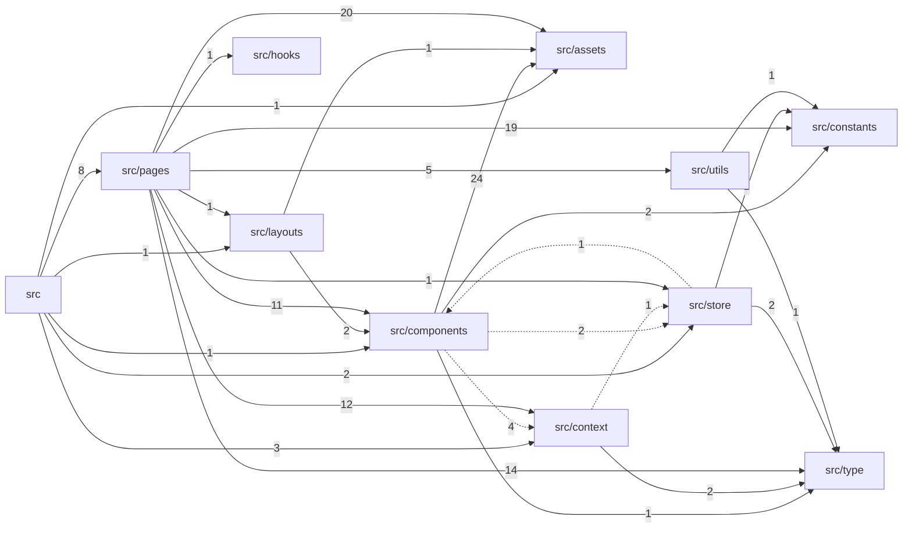

# Structure Map

Generated by `map_structure.py` on 2026-10-13 at commit `bc392d5`. Evidence for judgement, not a verdict: read each finding, then decide. Regenerate when the commit differs from `git rev-parse --short HEAD`.

- Files: 129 source, 0 test; 98 top-level symbols; typescript 128, javascript 1
- Packs: `references/languages/typescript.md`, `references/languages/javascript.md`, `references/frameworks/react.md`
- Components: 12 at depth 2; 1 cycle(s)

## Findings

| Finding | Count |
| --- | --- |
| Misplaced | 0 |
| Mixed | 0 |
| Duplicates | 0 |
| Name clashes | 2 |
| Synonyms | 0 |
| Families | 0 |
| Junk drawers | 1 |
| Flat folders | 0 |
| Unreferenced | 1 |
| Comment-heavy | 0 |
| Names | 8 |
| Cycles | 1 |

### Name clashes

- `CollapseUser` (js): `src/pages/request-mod/api/User.ts:1`, `src/pages/users/api/User.ts:1`
- `DetailUser` (js): `src/pages/request-mod/api/User.ts:8`, `src/pages/users/api/User.ts:8`

### Junk drawers

- `src/utils/` is named for no concept; split it: `CalcStatistics.ts`, `UploadImage.ts`: give each file a named home.

### Unreferenced

- `src/assets/theme/functions/gradientChartLine.tsx` is possibly unused: no file imports it.

### Names

- vague (N1): 8 — `data` (`src/context/notify.tsx:55`), `res` (`src/pages/dashboard/api/bookingStatistics.ts:5`), `res` (`src/pages/dashboard/api/salesStatistics.ts:5`), `res` (`src/pages/dashboard/api/userStatistics.ts:5`), `res` (`src/pages/dashboard/components/Sales.tsx:62`), ...
- ... and 3 more in structure.json

### Cycles

- `src/components` <-> `src/context` <-> `src/store` (src/components -> src/context x4, src/components -> src/store x2, src/context -> src/store x1, src/store -> src/components x1)

## Proposed moves

No moves proposed.

## Tree

| Folder | Role | Files | Symbols | Flagged |
| --- | --- | --- | --- | --- |
| `.` | - | 2 | 0 | 0 |
| `src` | - | 3 | 3 | 0 |
| `src/assets/theme` | - | 1 | 0 | 0 |
| `src/assets/theme/base` | - | 6 | 0 | 0 |
| `src/assets/theme/components` | component | 11 | 0 | 0 |
| `src/assets/theme/components/button` | component | 5 | 0 | 0 |
| `src/assets/theme/components/card` | component | 3 | 0 | 0 |
| `src/assets/theme/components/form` | component | 10 | 0 | 0 |
| `src/assets/theme/components/list` | component | 3 | 0 | 0 |
| `src/assets/theme/components/menu` | component | 2 | 0 | 0 |
| `src/assets/theme/components/table` | component | 3 | 0 | 0 |
| `src/assets/theme/functions` | - | 6 | 6 | 0 |
| `src/components` | component | 11 | 10 | 0 |
| `src/constants` | - | 2 | 0 | 0 |
| `src/context` | context | 3 | 13 | 0 |
| `src/hooks` | hook | 1 | 1 | 0 |
| `src/layouts` | - | 2 | 3 | 0 |
| `src/pages/amenities` | - | 1 | 1 | 0 |
| `src/pages/amenities/api` | api | 5 | 7 | 0 |
| `src/pages/amenities/components` | component | 1 | 1 | 0 |
| `src/pages/dashboard` | - | 1 | 1 | 0 |
| `src/pages/dashboard/api` | api | 3 | 3 | 0 |
| `src/pages/dashboard/components` | component | 12 | 16 | 0 |
| `src/pages/locations` | - | 1 | 1 | 0 |
| `src/pages/locations/api` | api | 5 | 5 | 0 |
| `src/pages/locations/components` | component | 1 | 1 | 0 |
| `src/pages/login` | - | 2 | 1 | 0 |
| `src/pages/login/api` | api | 1 | 3 | 0 |
| `src/pages/request-mod` | - | 2 | 1 | 0 |
| `src/pages/request-mod/api` | api | 5 | 4 | 1 |
| `src/pages/request-mod/components` | component | 1 | 1 | 0 |
| `src/pages/users` | - | 2 | 2 | 0 |
| `src/pages/users/api` | api | 3 | 4 | 1 |
| `src/store` | - | 2 | 1 | 0 |
| `src/store/auth` | - | 2 | 1 | 0 |
| `src/type` | - | 3 | 6 | 0 |
| `src/utils` | - | 2 | 2 | 0 |

## Components

| Component | Files | Ca | Ce | I | A | D |
| --- | --- | --- | --- | --- | --- | --- |
| `src/pages` | 46 | 1 | 22 | 0.96 | 1.00 | 0.96 |
| `src/layouts` | 2 | 2 | 3 | 0.60 | 1.00 | 0.60 |
| `.` | 2 | 0 | 0 | - | - | - |
| `src` | 3 | 0 | 16 | 1.00 | - | - |
| `src/assets` | 50 | 21 | 0 | 0.00 | - | - |
| `src/components` | 11 | 12 | 16 | 0.57 | - | - |
| `src/constants` | 2 | 23 | 0 | 0.00 | - | - |
| `src/context` | 3 | 16 | 3 | 0.16 | - | - |
| `src/hooks` | 1 | 1 | 0 | 0.00 | - | - |
| `src/store` | 4 | 6 | 3 | 0.33 | - | - |
| `src/type` | 3 | 19 | 0 | 0.00 | - | - |
| `src/utils` | 2 | 5 | 2 | 0.29 | - | - |

## Files

| File | Role | Symbols | Purpose |
| --- | --- | --- | --- |
| `.eslintrc.cjs` | - | - | - |
| `src/App.tsx` | component | `NotAuthElement`, `ProtectedElement`, `App` | - |
| `src/assets/theme/base/borders.ts` | - | - | - |
| `src/assets/theme/base/boxShadows.ts` | - | - | - |
| `src/assets/theme/base/breakpoints.ts` | - | - | - |
| `src/assets/theme/base/colors.ts` | - | - | - |
| `src/assets/theme/base/globals.ts` | - | - | - |
| `src/assets/theme/base/typography.ts` | - | - | - |
| `src/assets/theme/components/appBar.tsx` | component | - | - |
| `src/assets/theme/components/avatar.tsx` | component | - | - |
| `src/assets/theme/components/breadcrumbs.tsx` | component | - | - |
| `src/assets/theme/components/button/contained.tsx` | component | - | - |
| `src/assets/theme/components/button/index.tsx` | component | - | - |
| `src/assets/theme/components/button/outlined.tsx` | component | - | - |
| `src/assets/theme/components/button/root.tsx` | component | - | - |
| `src/assets/theme/components/button/text.tsx` | component | - | - |
| `src/assets/theme/components/buttonBase.tsx` | component | - | - |
| `src/assets/theme/components/card/cardContent.tsx` | component | - | - |
| `src/assets/theme/components/card/cardMedia.tsx` | component | - | - |
| `src/assets/theme/components/card/index.tsx` | component | - | - |
| `src/assets/theme/components/container.tsx` | component | - | - |
| `src/assets/theme/components/divider.tsx` | component | - | - |
| `src/assets/theme/components/form/autocomplete.tsx` | component | - | - |
| `src/assets/theme/components/form/checkbox.tsx` | component | - | - |
| `src/assets/theme/components/form/formControlLabel.tsx` | component | - | - |
| `src/assets/theme/components/form/formLabel.tsx` | component | - | - |
| `src/assets/theme/components/form/input.tsx` | component | - | - |
| `src/assets/theme/components/form/inputLabel.tsx` | component | - | - |
| `src/assets/theme/components/form/inputOutlined.tsx` | component | - | - |
| `src/assets/theme/components/form/select.tsx` | component | - | - |
| `src/assets/theme/components/form/switchButton.tsx` | component | - | - |
| `src/assets/theme/components/form/textField.tsx` | component | - | - |
| `src/assets/theme/components/icon.tsx` | component | - | - |
| `src/assets/theme/components/iconButton.tsx` | component | - | - |
| `src/assets/theme/components/linearProgress.tsx` | component | - | - |
| `src/assets/theme/components/list/index.tsx` | component | - | - |
| `src/assets/theme/components/list/listItem.tsx` | component | - | - |
| `src/assets/theme/components/list/listItemText.tsx` | component | - | - |
| `src/assets/theme/components/menu/index.tsx` | component | - | - |
| `src/assets/theme/components/menu/menuItem.tsx` | component | - | - |
| `src/assets/theme/components/sidenav.tsx` | component | - | - |
| `src/assets/theme/components/svgIcon.tsx` | component | - | - |
| `src/assets/theme/components/table/tableCell.tsx` | component | - | - |
| `src/assets/theme/components/table/tableContainer.tsx` | component | - | - |
| `src/assets/theme/components/table/tableHead.tsx` | component | - | - |
| `src/assets/theme/functions/boxShadow.ts` | - | `boxShadow` | - |
| `src/assets/theme/functions/gradientChartLine.tsx` | - | `gradientChartLine` | - |
| `src/assets/theme/functions/hexToRgb.ts` | - | `hexToRgb` | - |
| `src/assets/theme/functions/linearGradient.ts` | - | `linearGradient` | - |
| `src/assets/theme/functions/pxToRem.ts` | - | `pxToRem` | - |
| `src/assets/theme/functions/rgba.ts` | - | `rgba` | - |
| `src/assets/theme/index.ts` | - | - | - |
| `src/components/Breadcrumbs.tsx` | component | `Breadcrumbs` | - |
| `src/components/DataTable.tsx` | component | `GridColDefMe`, `DataTable` | - |
| `src/components/Filter.tsx` | component | - | - |
| `src/components/GradientBox.tsx` | component | `ColorType`, `GradientBox` | - |
| `src/components/GradientButton.tsx` | component | `GButton` | - |
| `src/components/Loading.tsx` | component | - | - |
| `src/components/Navbar.tsx` | component | - | - |
| `src/components/NotFound.tsx` | component | - | - |
| `src/components/Notifications.tsx` | component | `NotifyType`, `Notifys` | - |
| `src/components/Sidenav.tsx` | component | `LinkItem`, `Sidenav` | - |
| `src/components/StatisticsFilter.tsx` | component | - | - |
| `src/constants/AxiosInstance.ts` | - | - | - |
| `src/constants/routes.tsx` | - | - | - |
| `src/context/filter.tsx` | context | `UsersParams`, `FilterContextType`, `useFilter`, `FilterProvider` | - |
| `src/context/notify.tsx` | context | `AnyObject`, `NotifyContextValue`, `useNotify`, `NotifyProvider` | - |
| `src/context/statistics.tsx` | context | `TypeReport`, `Analyst`, `StatisticsContextType`, `useStatistic`, `StatisticsProvider` | - |
| `src/hooks/useWindowSize.tsx` | hook | `useWindowSize` | - |
| `src/layouts/basic.tsx` | component | `BasicLayoutProps`, `BasicLayout` | - |
| `src/layouts/dashboard.tsx` | component | `MainLayout` | - |
| `src/main.tsx` | - | - | - |
| `src/pages/amenities/api/Amenity.ts` | api | `Amenity`, `AddAmenityDTO`, `UpdateAmenityDTO` | - |
| `src/pages/amenities/api/addAmenity.ts` | api | `addAmenity` | - |
| `src/pages/amenities/api/deleteAmenity.ts` | api | `deleteAmenity` | - |
| `src/pages/amenities/api/getList.ts` | api | `getAmenities` | - |
| `src/pages/amenities/api/updateAmenity.ts` | api | `updateAmenity` | - |
| `src/pages/amenities/components/ManageAmenity.tsx` | component | `MangageAmenityProps` | - |
| `src/pages/amenities/index.tsx` | component | `Amenities` | - |
| `src/pages/dashboard/api/bookingStatistics.ts` | api | `bookingGrowth` | - |
| `src/pages/dashboard/api/salesStatistics.ts` | api | `salesGrowth` | - |
| `src/pages/dashboard/api/userStatistics.ts` | api | `userGrowth` | - |
| `src/pages/dashboard/components/BookingStatisticsCard.tsx` | component | `BookingStatisticsCard` | - |
| `src/pages/dashboard/components/BookingsReport.tsx` | component | `BookingsReport` | - |
| `src/pages/dashboard/components/ReportsBarChart.tsx` | component | `ReportsBarChart` | - |
| `src/pages/dashboard/components/ReportsLineChart.tsx` | component | `ReportsLineChart` | - |
| `src/pages/dashboard/components/ReportsMultiLineChart.tsx` | component | `ReportsMultiLineChart` | - |
| `src/pages/dashboard/components/Sales.tsx` | component | `RowType`, `RevenueResponse`, `Sales` | - |
| `src/pages/dashboard/components/SalesReport.tsx` | component | `SalesReport` | - |
| `src/pages/dashboard/components/SalesStatisticsCard.tsx` | component | `SalesStasticsCard` | - |
| `src/pages/dashboard/components/StatisticsCard.tsx` | component | `ComplexStatisticsCard` | - |
| `src/pages/dashboard/components/UsersReport.tsx` | component | `UsersReport` | - |
| `src/pages/dashboard/components/UsersStatisticsCard.tsx` | component | `UsersStatisticsCard` | - |
| `src/pages/dashboard/components/type.ts` | component | `ColorType`, `ReportChartType`, `ReportMultiChartType` | - |
| `src/pages/dashboard/index.tsx` | component | `DashBoard` | - |
| `src/pages/locations/api/Location.ts` | api | `Location`, `AddLocationDTO`, `UpdateLocationDTO` | - |
| `src/pages/locations/api/addLocation.ts` | api | `addLocation` | - |
| `src/pages/locations/api/deleteLocation.ts` | api | - | - |
| `src/pages/locations/api/getList.ts` | api | `getLocations` | - |
| `src/pages/locations/api/updateLocation.ts` | api | - | - |
| `src/pages/locations/components/ManageLocation.tsx` | component | `MangageLocationProps` | - |
| `src/pages/locations/index.tsx` | component | `Locations` | - |
| `src/pages/login/api/login.ts` | api | `LoginData`, `LoginResponse`, `login` | - |
| `src/pages/login/index.tsx` | component | `Login` | - |
| `src/pages/login/schema.ts` | - | - | - |
| `src/pages/request-mod/api/User.ts` | api | `CollapseUser`, `DetailUser` | - |
| `src/pages/request-mod/api/acceptRequest.ts` | api | `acceptMod` | - |
| `src/pages/request-mod/api/denyRequest.ts` | api | - | - |
| `src/pages/request-mod/api/getDetail.ts` | api | `getUser` | - |
| `src/pages/request-mod/api/getList.ts` | api | - | - |
| `src/pages/request-mod/components/UserCard.tsx` | component | `UserCard` | - |
| `src/pages/request-mod/detail.tsx` | - | - | - |
| `src/pages/request-mod/index.tsx` | component | `RequestsMod` | - |
| `src/pages/users/api/User.ts` | api | `CollapseUser`, `DetailUser` | - |
| `src/pages/users/api/getDetail.ts` | api | `getUser` | - |
| `src/pages/users/api/getList.tsx` | api | `getUsers` | - |
| `src/pages/users/detail.tsx` | - | - | - |
| `src/pages/users/index.tsx` | component | `RowType`, `Users` | - |
| `src/store/ReduxProvider.tsx` | - | `ReduxProvider` | - |
| `src/store/auth/slice.ts` | - | - | - |
| `src/store/auth/type.ts` | - | `AuthStateType` | - |
| `src/store/index.ts` | - | - | - |
| `src/type/Paging.ts` | - | `PagingParams`, `PagingResponse` | - |
| `src/type/Statistics.ts` | - | `Column`, `StatisticsParam`, `StatisticsResponse` | - |
| `src/type/User.ts` | - | `User` | - |
| `src/utils/CalcStatistics.ts` | - | `CalcStatistics` | - |
| `src/utils/UploadImage.ts` | - | `UploadImage` | - |
| `src/vite-env.d.ts` | - | - | - |
| `vite.config.ts` | - | - | - |
